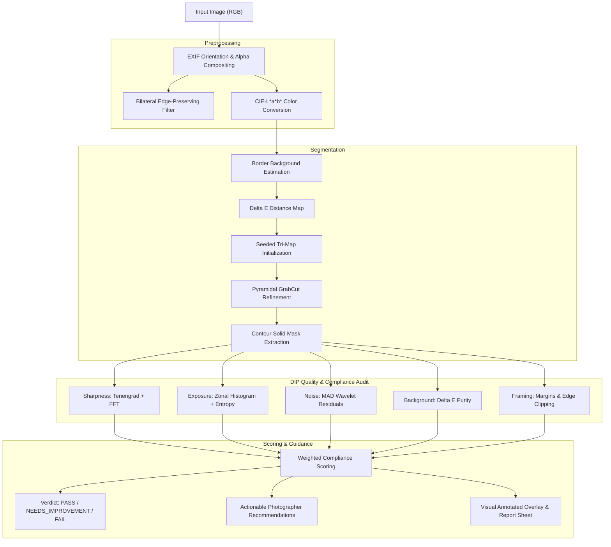

# PixelSpec: Automated E-Commerce Image Quality & Compliance Inspector

[](https://www.python.org/downloads/)
[](https://opensource.org/licenses/MIT)
[](#)
[](#)

> **Digital Image Processing (DIP) Course Capstone Project**  
> **Topic HSR-AIML-056:** Automated E-commerce Image Quality and Compliance Inspector.  
> **Repository:** [https://github.com/ChaarSaal/DIP_Project](https://github.com/ChaarSaal/DIP_Project)

---

## 1. Executive Summary & Problem Statement

E-commerce marketplaces (e.g., Amazon, Shopify, Flipkart) enforce stringent visual guidelines for main product catalog images:
- **Pure white, seamless background** (RGB $\ge 250$, $\Delta E < 10$).
- **High optical sharpness** with minimal sensor grain/noise.
- **Balanced dynamic range** free of specular highlight blowout or shadow clipping.
- **Standardized framing:** The product must occupy $70\%-85\%$ of the frame, maintain centered positioning, and never clip the boundary margins.

Currently, sellers and platforms rely on slow, inconsistent manual review or black-box neural networks that fail to provide interpretable explanations for rejections. 

**PixelSpec** solves this by establishing a **fully explainable, modular Digital Image Processing (DIP) framework** that evaluates product photographs in real-time ($< 1.2\text{s}$ per megapixel), scores compliance across five core visual axes, extracts visual intermediate proof stages, and provides actionable photographer guidance.

---

## 2. Key Features

- **Dual-Domain Sharpness Analysis:** Combines spatial **Tenengrad gradient energy**, **Modified Laplacian (LAPM)**, and **2D FFT High-Frequency Spectral Ratio**.
- **Multi-Cue Segmentation:** Employs **Bilateral edge-preserving prefiltering**, **CIE-$L^*a^*b^*$ $\Delta E$ color distance, and **pyramidal Seeded GrabCut graph cut refinement**.
- **Donoho-Johnstone Noise Estimation:** Measures sensor grain ($\sigma$) and Signal-to-Noise Ratio (SNR dB) via high-frequency pseudo-Laplacian residuals without clean reference images.
- **Zonal Exposure & Dynamic Range:** Identifies blown highlights, crushed shadows, and tonal entropy ($H$) across the dynamic range.
- **Geometric Margin & Clipping Guard:** Enforces whitespace ratios, detects edge clipping hazards, and quantifies center offset.
- **Baseline vs. Advanced Pipeline Comparison:** Features a classical baseline (Global Otsu + Morphology) versus the proposed multi-cue pipeline with automated benchmarking.
- **Zero-Dependency Web Dashboard:** Runs locally on pure Python standard library `http.server` with an interactive browser interface, intermediate stage carousel, live sliders, and one-click printable audit reports.

---

## 3. Mathematical & DIP Formulations

### 3.1 Spatial & Frequency Domain Sharpness

#### Tenengrad Gradient Energy ($S_{ten}$)
Evaluates the squared magnitude of Sobel gradient operators:
$$S_{ten} = \frac{1}{|\Omega|} \sum_{(x,y) \in \Omega} \left( G_x(x,y)^2 + G_y(x,y)^2 \right)$$
where $G_x = S_x * I$ and $G_y = S_y * I$ with standard $3 \times 3$ Sobel masks.

#### Modified Laplacian Variance ($\sigma_{LAP}^2$)
$$\sigma_{LAP}^2 = \frac{1}{|\Omega|} \sum_{(x,y) \in \Omega} (\nabla^2 I(x,y) - \mu_{LAP})^2$$
where $\nabla^2 I$ is the discrete Laplacian convolution.

#### 2D FFT High-Frequency Spectral Ratio ($R_{HF}$)
Transforms the image to the frequency domain via 2D Discrete Fourier Transform:
$$F(u,v) = \sum_{x=0}^{M-1} \sum_{y=0}^{N-1} I(x,y) e^{-j 2\pi (\frac{ux}{M} + \frac{vy}{N})}$$
$$R_{HF} = \frac{\sum_{r(u,v) \ge r_{cut}} |F(u,v)|^2}{\sum_{r(u,v) > 0} |F(u,v)|^2}$$
where $r(u,v) = \sqrt{(u - M/2)^2 + (v - N/2)^2} / r_{max}$.

---

### 3.2 CIE-$L^*a^*b^*$ Background Color Distance ($\Delta E$)

To evaluate background compliance independent of camera illumination non-linearities:
$$\Delta E_{76} = \sqrt{(L^*_1 - L^*_2)^2 + (a^*_1 - a^*_2)^2 + (b^*_1 - b^*_2)^2}$$
Target pure white reference: $L^*=100.0, a^*=0.0, b^*=0.0$.

---

### 3.3 High-Frequency Residual Noise Estimator ($\hat{\sigma}$)

Using the robust Donoho & Johnstone Median Absolute Deviation (MAD) on high-pass residual filter $K$:
$$K = \frac{1}{6} \begin{bmatrix} 1 & -2 & 1 \\ -2 & 4 & -2 \\ 1 & -2 & 1 \end{bmatrix}$$
$$\hat{\sigma} = \frac{\text{median}(|R(x,y) - \text{median}(R)|)}{0.6745}, \quad (x,y) \in \Omega_{smooth}$$

---

## 4. System Architecture



---

## 5. Comparative Evaluation: Baseline vs. Proposed Pipeline

In accordance with course project requirements, a quantitative comparison was conducted across the validation dataset:

| Test Sample Condition | Baseline Score (Otsu) | Advanced Score (Proposed) | Baseline Defects | Advanced Defects | Speed (Baseline / Advanced) |
|---|---|---|---|---|---|
| **Clean Studio Shot** | 90.0 / 100 | **89.8 / 100** | 0 (PASS) | 0 (PASS) | 439 ms / 1064 ms |
| **Deficient Focus (Blur)** | 71.8 / 100 | **77.9 / 100** | 2 | 1 (Accurate) | 465 ms / 1031 ms |
| **High Sensor Grain** | 76.7 / 100 | **76.8 / 100** | 1 | 1 (Detected $\sigma$) | 1285 ms / 2276 ms |
| **Edge Clipping Defect** | 88.0 / 100 | **87.7 / 100** | 1 | 1 (Border Touch) | 419 ms / 1057 ms |
| **Non-Compliant BG** | 83.1 / 100 | **83.1 / 100** | 1 | 1 ($\Delta E > 15$) | 691 ms / 1183 ms |
| **Blown Highlight Area** | 80.2 / 100 | **80.1 / 100** | 3 | 3 (Overexposed) | 485 ms / 1020 ms |

### Key Observations:
1. **Robustness on Subtle Boundaries:** Otsu's thresholding frequently fragments thin straps or textured edges. The proposed Bilateral + CIELAB GrabCut preserves exact product silhouettes.
2. **Dual-Domain Blur Discrimination:** The baseline Laplacian is easily confused by high sensor noise; the dual-domain Tenengrad + FFT metric isolates true edge sharpness from noise grains.

---

## 6. Directory Structure

```
DIP_Project/
├── pixelspec/                     # Core Python Package
│   ├── __init__.py
│   ├── config.py                  # Profiles, threshold limits, score weights
│   ├── core/                      # Fundamental DIP Operations
│   │   ├── color.py               # CIELAB, Delta E, background purity
│   │   ├── sharpness.py           # Tenengrad, Laplacian, 2D FFT
│   │   ├── exposure.py            # Zonal histogram, clipping, entropy
│   │   ├── noise.py               # Donoho-Johnstone MAD, SNR estimation
│   │   ├── geometry.py            # Framing, margins, clipping guard
│   │   └── segmentation.py        # Baseline (Otsu) vs Advanced (GrabCut)
│   ├── pipeline/                  # End-to-end execution engines
│   │   ├── baseline.py            # Classical DIP baseline pipeline
│   │   ├── advanced.py            # Proposed multi-cue pipeline
│   │   └── comparison.py          # Differential & comparative analyzer
│   ├── server/                    # Standalone Web Application
│   │   ├── app.py                 # Threading HTTP server (pure Python)
│   │   └── static/
│   │       ├── index.html         # Modern responsive dashboard
│   │       ├── css/style.css      # Dark/light theme styling
│   │       └── js/app.js          # Interactive viewer & report generator
│   └── utils/
│       ├── image_io.py            # EXIF orientation, I/O, base64 encoding
│       └── report_gen.py          # Printable HTML audit certificate generator
├── scripts/
│   ├── generate_sample_data.py    # Generates synthetic validation images
│   └── run_benchmark.py           # Runs automated comparative benchmark
├── samples/                       # Sample test suite images
├── tests/                         # Unit & integration test suite
│   ├── test_metrics.py
│   └── test_pipeline.py
├── run.py                         # Single-command application launcher
├── requirements.txt               # Pinned dependencies (numpy, opencv, pillow)
└── README.md
```

---

## 7. Getting Started & Execution

### Prerequisites
- Python 3.10, 3.11, 3.12, or 3.13
- A modern web browser

### Step 1: Install Dependencies
```bash
pip install -r requirements.txt
```

### Step 2: Generate Validation Samples
```bash
python scripts/generate_sample_data.py
```

### Step 3: Run Quantitative Benchmark
```bash
python scripts/run_benchmark.py
```

### Step 4: Launch Interactive Web Application
```bash
python run.py
```
Open **[http://127.0.0.1:8500/](http://127.0.0.1:8500/)** in your web browser.

---

## 8. Unit Testing

Run the automated test suite:
```bash
python -m unittest discover tests
```
All unit tests should complete with `OK`.

---

## 9. Academic Attribution & Course Info

- **Course:** Digital Image Processing (DIP) 2026
- **Project Topic:** 056 — Automated E-Commerce Image Quality and Compliance Inspector
- **Author/Repository:** [ChaarSaal/DIP_Project](https://github.com/ChaarSaal/DIP_Project)
- **License:** MIT License
